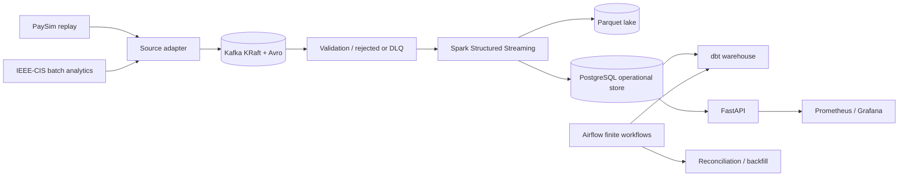

# FinStream — Real-Time Financial Transaction Streaming & Fraud Detection Platform

FinStream is Project 02 in a data-engineering portfolio: a local-first foundation for replaying public historical transaction data, processing it with Kafka and Spark Structured Streaming, persisting trusted outputs, and serving operational data. It is a data platform project, not a claim of live-bank connectivity or a completed ML system.

## Status

**Foundation is implemented; integration is not yet run.** Canonical contracts, source adapters, a Kafka KRaft profile, Schema Registry assets, a Spark stream definition, PostgreSQL DDL, dbt project, Airflow DAG foundations, FastAPI routes, monitoring configuration, Terraform foundations, tests, and runbooks are included. Raw data, cloud resources, credentials, measured benchmarks, and production deployment are deliberately absent.

## Architecture



PaySim and IEEE-CIS remain distinct source domains. Their original IDs, provenance, simulation IDs, timestamps, and historical labels are preserved. A historical label is never treated as a generated alert or score.

## Stack

Python 3.11, SQL, Kafka KRaft, Schema Registry and Avro, Spark Structured Streaming, S3/Parquet (local file-backed lake in development), PostgreSQL, dbt Core, Airflow 3, FastAPI, Docker Compose profiles, Terraform, GitHub Actions, Prometheus, Grafana, and CloudWatch planning. Flink and Iceberg are explicitly future evaluation items.

## Start locally

1. Work inside the WSL2 Linux filesystem, not a Windows-mounted project folder.
2. Copy `.env.example` to `.env`, replace every `replace-*` value, and keep it private.
3. Start only the profile required for the current phase:

   ```bash
   docker compose --env-file .env --profile core up -d postgres
   docker compose --env-file .env --profile streaming up -d kafka schema-registry init-topics
   docker compose --env-file .env --profile api up -d --build api
   ```

4. Use `make spark-run` only after Kafka topics and Schema Registry contracts have been registered. Do not run every profile together on a 16 GB laptop.

See [the local setup guide](docs/deployment/local-setup.md), [reliability model](docs/operations/reliability.md), and [project status](PROJECT_STATUS.md).

## Delivery semantics and recovery

The producer uses idempotence and bounded retry settings. Spark checkpoints progress, watermarks event time, and deduplicates by stable `event_id`. PostgreSQL has unique keys and conflict-safe inserts. These controls can support **effectively-once outcomes for a defined sink**, but they do **not** prove end-to-end exactly-once processing. Failures, replay, offset ranges, late events, and source-to-sink reconciliation are documented in the [recovery runbook](docs/operations/recovery-runbook.md).

## Repository map

- `ingestion/`: adapters, validation, replay, and Kafka producer primitives.
- `streaming/`: Kafka contracts/topics and Spark streaming definition.
- `storage/`, `sql/`: Parquet policy, operational repository, DDL, indexes, reconciliation.
- `warehouse/dbt/`: sources, models, tests, snapshot, and macro.
- `orchestration/airflow/`: finite workflow DAG foundations.
- `api/`: read-only operational endpoints; no fake payloads.
- `monitoring/`: Prometheus, alert rules, and Grafana provisioned dashboard.
- `infrastructure/terraform/`: opt-in encrypted S3/IAM foundation only.
- `docs/`: setup, operations, security, cost, decisions, and roadmap.

## Testing and roadmap

Run `make test`, `make lint`, and `make validate` after installing Python 3.11 dependencies. CI runs these offline checks; Docker, Terraform, dbt, and Airflow runtime tests require their respective tools and deliberately do not fabricate success.

Next: acquire data outside Git, profile each source, register schemas, run a bounded PaySim replay, validate recovery behavior, and record measured results. See [completion checklist](docs/architecture/completion-checklist.md).

## Limitations

This foundation is not a deployed service, live financial feed, security certification, fraud model, or benchmark. Single-broker Kafka is development-only; the local Parquet path is not an S3 deployment; the Airflow tasks are explicit scaffold boundaries until their parameters/operators are implemented.
