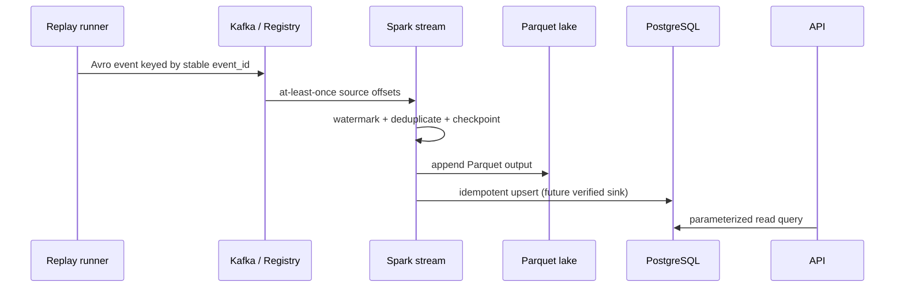

# Detailed system architecture

The SQL primary key and producer idempotence reduce duplicate effects but do not
turn multiple independent systems into one global transaction. Reconciliation
compares input manifests, Kafka offset ranges, lake records, and operational
store unique IDs after bounded runs.
